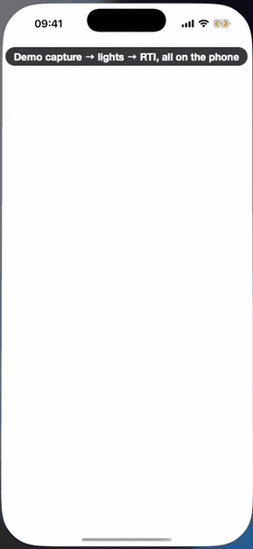
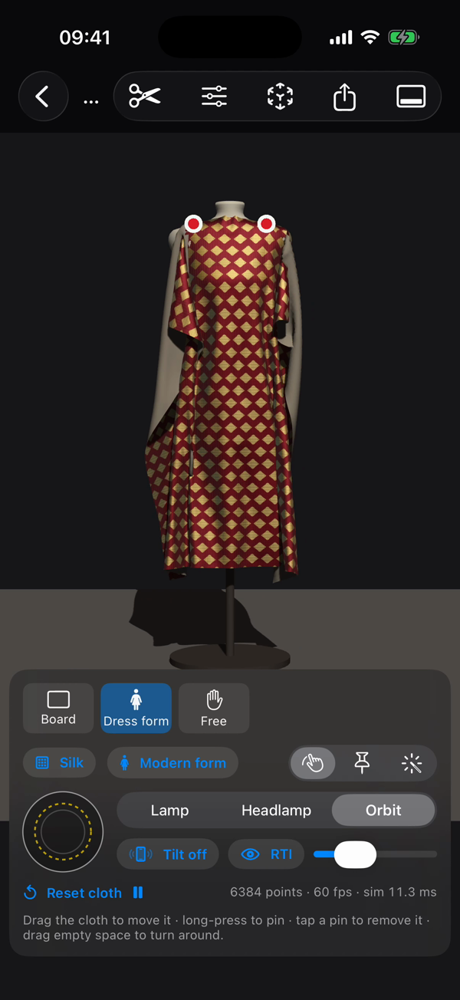
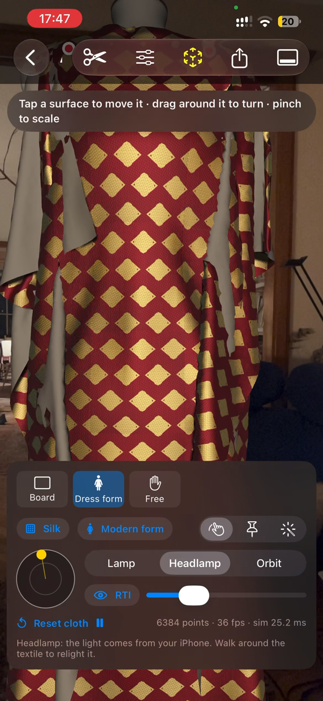

# relightCam (iOS)

This folder is part of a fork of [cnr-isti-vclab/relight](https://github.com/cnr-isti-vclab/relight).
Run the commands below from this `ios/` folder.

An iPhone app that captures and processes RTIs (relightable images) on the phone, then lets you explore
them in 2D, on a simulated 3D cloth, and in AR. The capture-to-RTI part reimplements the pipeline of
[relight](https://github.com/cnr-isti-vclab/relight) (CNR-ISTI Visual Computing Lab) in Swift. relight
itself is a Qt desktop/CLI toolkit and has no iOS app. The 3D cloth viewer is aimed at historical
textiles and samples.

<p align="center">

</p>

The GIF shows the built-in demo capture (a synthetic silk lampas) going through light detection and the RTI
build, the 2D viewer, the 3D cloth viewer (dress form, settings, cutout, a 1770s form, a board under an
orbiting raking light) and, at the end, live AR recorded on an iPhone 13 Pro.

<p>




</p>

## Workflow

1. **Capture.** Put the iPhone on a tripod with a shiny black sphere next to the object, and move a hand-held
   light between shots (focus, exposure and white balance locked; ≈12 MP frames on an interval timer).
   Or import photos, or try **Demo capture: silk textile**.
2. **Light directions.** Place a circle on the sphere; the app finds the highlight in every photo.
   Enter the sphere's real diameter to give the RTI its real size.
3. **Build RTI.** PTM or HSH, written in relight's web format.
4. **View**, with two viewers:
   - **Open relightable image**: the classic 2D RTI viewer. Drag, or tilt the phone, to move the light.
   - **Open in 3D cloth viewer**: the same RTI draped on a simulated cloth (below).
5. **Export.** An RTI zip with relight's OpenLIME web viewer; photos plus a `.lp` file for RelightLab; or a
   `.usdz` of the current drape.

## Pipeline

| Step | relight equivalent | File |
|---|---|---|
| Capture: locked focus/exposure/WB, full-res frames, interval timer | RelightLab image set | `Capture/` |
| Max-composite + sphere circle | `SpherePicking` | `Views/SphereView.swift` |
| Highlight → light direction (threshold sweep, shrinking-window centroid, 2× reflection angle) | `Sphere::findHighlight`, `Sphere::computeDirections` (orthographic) | `Core/LightDetection.swift` |
| PTM (6) / HSH (9) per-channel least squares, streamed photo by photo | `RtiBuilder` with `-b ptm` / `-b hsh`, colorspace rgb | `Core/RTIBuilder.swift`, `Core/RTIBasis.swift` |
| Photometric-stereo normal map | relight-normals (simplified, Lambertian LSQ) | `Core/RTIBuilder.swift` |
| Output `info.json` (+ `pixelSizeInMM`) and `plane_N.jpg` | relight web format | `Core/RTIBuilder.swift` |
| 2D viewer: drag or tilt; RTI / specular / shaded / normals | relight.js / OpenLIME shader | `Viewer/RTIMetalView.swift` |
| Export: RTI zip with OpenLIME `index.html`, photos + `.lp` | | `Core/Exporter.swift` |

Projects live in `Documents/Projects/<name>/`, which shows up in the Files app.

## 3D cloth viewer

The RTI stores how each point of the fabric responds to light *relative to the flat fabric*. The cloth
viewer evaluates it per fragment with the light expressed in that fragment's own frame on the deformed
cloth (rotated for the grain, mirrored for mirrored tiles), so folds light up the way the captured fabric
did. Design note: [docs/cloth-viewer.md](docs/cloth-viewer.md).

- **Supports:** a rigid **board** (mounted samples), a **dress form**, or **free** cloth hanging from pins.
- **Dress forms:** modern, 1770s stays + panniers, 1860s corset + crinoline, 1880s bustle, 1920s straight.
  The forms are generated from cross-sections.
- **Fabric:** silk, linen, wool and tapestry presets. **Grain angle**: 45° drapes on the bias.
  **Tiling** (repeat or mirror-repeat a marked pattern region) for a full length of fabric. Small samples
  (under 50 cm) open with tiling on, repeating the largest region that avoids the calibration sphere; the
  board always shows the sample itself at real size.
- **Tools:** *Move* (drag the cloth, long-press to pin, tap a pin to remove it), *Pin* (drop a point onto
  the form to pin it there), *Smooth* (press the cloth onto the form by hand).
- **Light:** a draggable dome. *Lamp* is fixed in the room, *Headlamp* follows the view, and *Orbit*
  circles the textile as a raking light. **Tilt**: *Room* (lamp and gravity stay in the room, so the cloth
  swings) or *Walk around*.
- **Look:** sheen for silk and metal threads (a half-vector approximation), the reverse side from a second
  project, a warp grainline, and RTI / specular / shaded / normals modes.
- **Outline and repeat** (scissors): the viewer uses the photo in one of two ways, and this editor covers
  both. *Outline* is the shape of the piece (automatic detection with Vision, sphere removal, Add/Erase
  brushes). It's used whenever the sample is shown once: on the board, or with tiling off. *Repeat* is the
  rectangle that's tiled when tiling is on. The editor says which of the two the current view uses and can
  switch tiling. It opens in a lower panel with the cloth still running above it: a new repeat shows on the
  cloth while you drag, and outline edits show when you lift your finger.
- **Live AR:** the same simulation and RTI shading over the camera image, anchored on a real floor or
  table, with shadows on the real floor. Drag, pin and smooth all work in AR, gravity is real, and
  *Headlamp* lights the textile from the phone itself: walk around it to relight it.
- **Share 3D model:** a `.usdz` of the current drape (base colour = RTI lit from above, normal map from
  photometric stereo) for AR Quick Look on any Apple device.

### Simulation

Small-step XPBD (Macklin et al. 2019) on a regular grid. Points are 1–1.5 cm apart on a 1 m panel; the
dress-form scene has about 6,400 points.

- Nearly inextensible along warp and weft, compliant along the bias.
- Long-range attachments to the pins (Kim et al. 2012), so pinned cloth doesn't sag.
- Pins glide to their targets instead of teleporting.
- Coulomb friction scaled by the contact push.
- Cloth-on-cloth collisions through a spatial hash.
- Bending is constrained as discrete curvature at three scales (spans of 1, 3 and 9 points), with
  rigidity from the **Peirce cantilever bending length** (1.2 cm silk, 3 cm linen, 2.5 cm wool, 7 cm
  tapestry). An overhang of twice the bending length droops to within 3.5° of the textile-standard 41.5°.

On an iPhone 13 Pro the dress-form scene runs at 60 fps (simulation ≈12 ms per frame), also in AR. The
simulation runs on its own thread, so the controls and sheets stay responsive; the 3D view pauses while a
sheet is open.

The viewer is a visual study, not a prediction: the drape uses fabric presets, and views at an angle are
approximated from a capture taken from straight above.

## Build and install

```bash
tools/install.sh               # build Release, wait for a connected iPhone, install and launch
tools/install.sh "My iPhone"   # a specific device
```

Requires Xcode 26+, iOS 17+. To build under your own account, change `DEVELOPMENT_TEAM` and
`PRODUCT_BUNDLE_IDENTIFIER` in `RelightCam.xcodeproj/project.pbxproj` (or in Xcode › Signing & Capabilities).
For a new phone: connect it by cable, turn on Developer Mode (Settings › Privacy & Security), then run the
script. It pairs the phone and registers it with your team (`-allowProvisioningDeviceRegistration`).
Wireless installs need a network that lets devices see each other (many university networks don't);
the iPhone's Personal Hotspot works.

## TestFlight

The project is set up for App Store Connect: export-compliance answer in `Config/Info.plist`
(`ITSAppUsesNonExemptEncryption` = NO, the app uses no encryption of its own), a privacy manifest
(`RelightCam/PrivacyInfo.xcprivacy`: no tracking, no data collected), a 1024 px opaque icon, and
automatic (cloud-managed) distribution signing.

```bash
tools/testflight.sh            # archive + signed .ipa in build/export (nothing is uploaded)
tools/testflight.sh --upload   # archive + upload to App Store Connect
```

Every run gets a new build number (`yyMMddHHmm`). Before the first upload, create the app in
[App Store Connect](https://appstoreconnect.apple.com) (*Apps › + › New App*, iOS, bundle ID
`be.uantwerpen.jverlinden.relightcam1`). That needs the App Manager or Admin role in the team. After
Apple has processed a build (10–30 minutes), add testers under *TestFlight*. Internal testers (team
members) can install right away; external testers need a short Beta App Review first.

## Tests

```bash
mkdir -p /tmp/rc && cp tools/pipeline_test.swift /tmp/rc/main.swift
swiftc -O RelightCam/Core/*.swift RelightCam/Cloth/*.swift /tmp/rc/main.swift -o /tmp/rc/test && /tmp/rc/test /tmp/rc/out

mkdir -p /tmp/ct && cp tools/cloth_test.swift /tmp/ct/main.swift
swiftc -O RelightCam/Core/*.swift RelightCam/Cloth/*.swift /tmp/ct/main.swift -o /tmp/ct/test && /tmp/ct/test
```

- `pipeline_test` renders a synthetic capture (embossed tablet plus a mirror sphere, 34 known lights),
  then checks light detection (median error 0.04°) and PTM/HSH reproduction (RMSE 5.0 / 3.8 out of 255).
  The exported folders were also checked in relight's OpenLIME viewer.
- `cloth_test` checks stretch, penetration, rest state and timing for every support, material and dress
  form, plus the Peirce calibration.

Simulator test hooks (launch arguments):
- Pipeline and screens: `-autorun` / `-autorun-textile` (demo → detect → HSH build), `-open-viewer`,
  `-open-sphere`, `-open-capture`, `-open-cloth`, `-scroll-view`.
- How it works and credits: `-open-help`, `-scroll-help`, `-open-credits`, `-open-license`.
- 2D viewer: `-light x,y`, `-mode n`, `-animate-light`.
- Cloth viewer: `-cloth-support board|dressForm|free`, `-cloth-form …`, `-cloth-material …`,
  `-cloth-grain deg`, `-cloth-light lamp|headlamp|orbit`, `-cloth-mode n`, `-cloth-open-settings`,
  `-cloth-open-mask`, `-cloth-ar`, `-cloth-export-test`, `-log-stats`.
- Outline and repeat editor (with `-cloth-open-mask`): `-mask-test-stroke` paints a timed 60-point stroke
  and removes the sphere (prints the timings); `-mask-test-region u0,v0,du,dv` sets the repeat rectangle.

## Limits

- Light directions use relight's orthographic sphere model (no lens/perspective correction).
- Only PTM/HSH in rgb colorspace; relight's default RBF+PCA (best quality) isn't ported yet. For that,
  export the photos + `.lp` and process them in RelightLab.
- Planes are written as JPEG quality 1.0, because ImageIO only disables chroma subsampling at maximum quality.
- The cloth viewer's angled views and sheen are approximations, and the automatic cutout needs a real
  device (Vision foreground masks don't run in the simulator).

## License

GPL-3.0 (see [`../LICENSE-GPL-3.0`](../LICENSE-GPL-3.0)). The app's *How it works › Credits and licenses*
page lists the components, their licenses and the methods, and includes the full GPL text. relightCam is an independent port and isn't affiliated
with CNR-ISTI. It follows the algorithms and formats of [relight](https://github.com/cnr-isti-vclab/relight)
(core LGPL-3.0, GPL-3.0 components) and bundles the [OpenLIME](https://github.com/cnr-isti-vclab/openlime)
viewer (GPL-3.0, CNR-ISTI Visual Computing Lab and CRS4) in `RelightCam/WebViewer/`.
