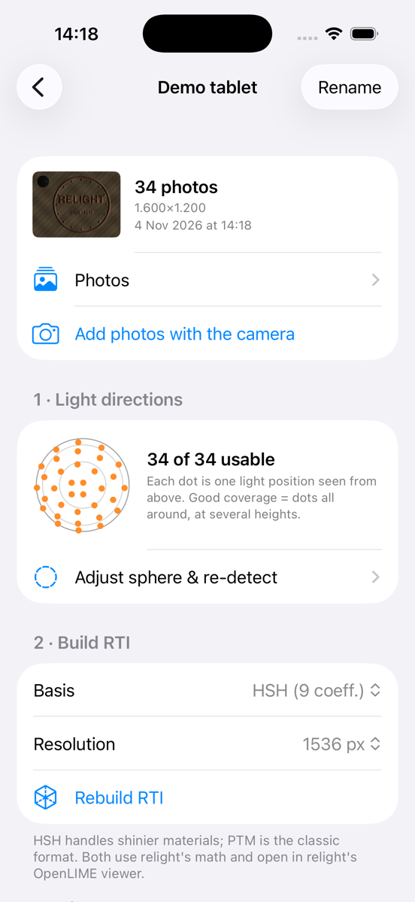
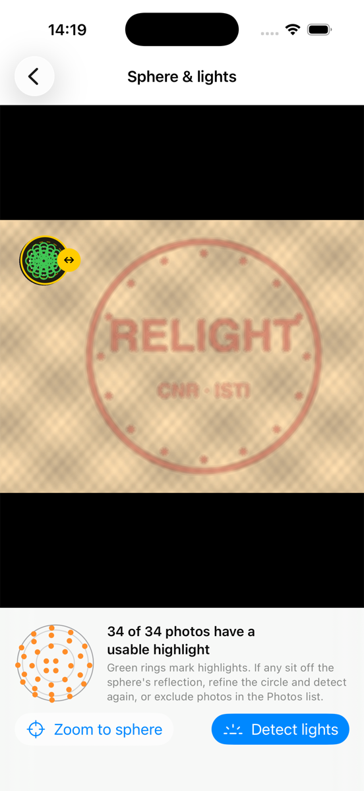
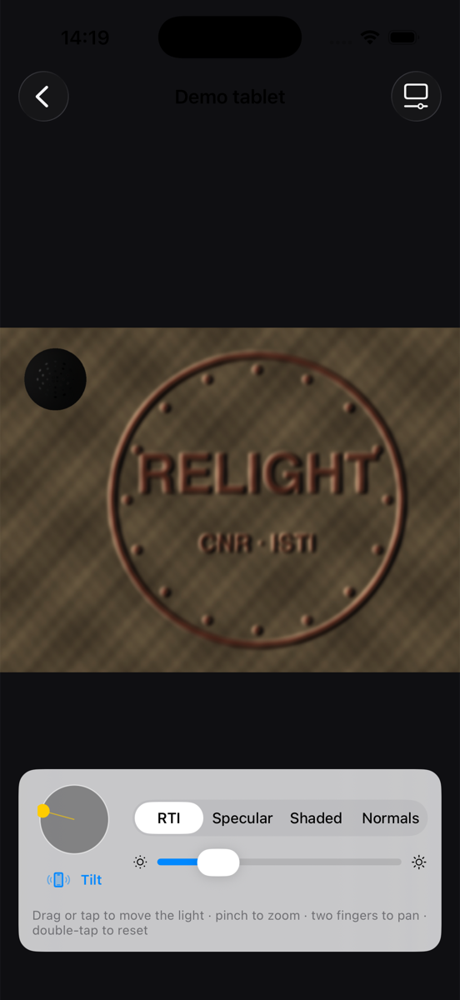

# RelightCam (iOS)

This folder is part of a fork of [cnr-isti-vclab/relight](https://github.com/cnr-isti-vclab/relight).
Run the commands below from this `ios/` folder.

An iPhone app that captures and processes RTIs (relightable images) on the phone. It reimplements
the capture-to-RTI pipeline of [relight](https://github.com/cnr-isti-vclab/relight) (CNR-ISTI Visual Computing Lab)
in Swift. relight itself is a Qt desktop/CLI toolkit and has no iOS app.

<p>



</p>

## Pipeline

| Step | relight equivalent | File |
|---|---|---|
| Capture: locked focus/exposure/WB, full-res frames (≈12 MP), interval timer | RelightLab image set | `Capture/CameraController.swift`, `Capture/CaptureView.swift` |
| Max-composite + sphere circle | `SpherePicking` | `Views/SphereView.swift` |
| Highlight → light direction (threshold sweep, shrinking-window centroid, 2× reflection angle) | `Sphere::findHighlight`, `Sphere::computeDirections` (orthographic) | `Core/LightDetection.swift` |
| PTM (6) / HSH (9) per-channel least squares, streamed photo by photo | `RtiBuilder` with `-b ptm` / `-b hsh`, colorspace rgb | `Core/RTIBuilder.swift`, `Core/RTIBasis.swift` |
| Photometric-stereo normal map | relight-normals (simplified, Lambertian LSQ) | `Core/RTIBuilder.swift` |
| Output `info.json` + `plane_N.jpg` | relight web format | `Core/RTIBuilder.swift` |
| Viewer: drag, or **tilt the phone** to move the light; RTI / specular / shaded / normals | relight.js / OpenLIME shader | `Viewer/` |
| Export: RTI zip (with relight's OpenLIME `index.html`), photos + `.lp` for RelightLab | | `Core/Exporter.swift` |

Projects live in `Documents/Projects/<name>/`, which shows up in the Files app.

## Build and install

```bash
tools/install.sh            # build Release, wait for a connected iPhone, install and launch
tools/install.sh "My iPhone"   # a specific device
```

Requires Xcode 26+, iOS 17+. To build under your own account, change `DEVELOPMENT_TEAM` and
`PRODUCT_BUNDLE_IDENTIFIER` in `RelightCam.xcodeproj/project.pbxproj` (or in Xcode › Signing & Capabilities).
For a new phone: connect it by cable, turn on Developer Mode (Settings › Privacy & Security), then run the
script. It pairs the phone and registers it with your team (`-allowProvisioningDeviceRegistration`).

## Tests

```bash
mkdir -p /tmp/rc && cp tools/pipeline_test.swift /tmp/rc/main.swift
swiftc -O RelightCam/Core/*.swift /tmp/rc/main.swift -o /tmp/rc/test && /tmp/rc/test /tmp/rc/out
```

This renders a synthetic capture (embossed tablet plus a mirror sphere, 34 known lights), then checks
light detection (median error 0.04°) and PTM/HSH reproduction (RMSE 5.0 / 3.8 out of 255). The
exported folders were also checked in relight's OpenLIME viewer.

Simulator test hooks (launch arguments): `-autorun` (demo → detect → HSH build), `-open-viewer`,
`-open-sphere`, `-open-capture`, `-light x,y`, `-mode n`.

## Limits of this first version

- Light directions use relight's orthographic sphere model (no lens/perspective correction).
- Only PTM/HSH in rgb colorspace; relight's default RBF+PCA (best quality) isn't ported yet. For that,
  export the photos + `.lp` and process them in RelightLab.
- Planes are written as JPEG quality 1.0, because ImageIO only disables chroma subsampling at maximum quality.

## License

GPL-3.0 (see [`../LICENSE-GPL-3.0`](../LICENSE-GPL-3.0)). RelightCam is an independent port and isn't affiliated with CNR-ISTI. It follows the
algorithms and formats of [relight](https://github.com/cnr-isti-vclab/relight) (core LGPL-3.0, GPL-3.0
components) and bundles the [OpenLIME](https://github.com/cnr-isti-vclab/openlime) viewer (GPL-3.0, CNR-ISTI Visual Computing Lab
and CRS4) in `RelightCam/WebViewer/`.
